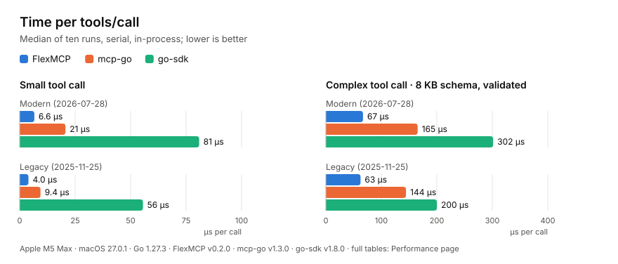

<div align="center">


**A high-performance Go implementation of the Model Context Protocol, tuned for busy servers that answer many complex tool calls.**

[](https://github.com/pbednarcik/FlexMCP/actions/workflows/ci.yml)
[](go.mod)
[](LICENSE)
[](https://github.com/pbednarcik/FlexMCP/actions/workflows/ci.yml)
[](https://github.com/pbednarcik/FlexMCP/actions/workflows/ci.yml)
[](https://github.com/pbednarcik/FlexMCP/actions/workflows/ci.yml)

</div>

## What FlexMCP is

FlexMCP began as a fork of [mark3labs/mcp-go](https://github.com/mark3labs/mcp-go), the Go library for building MCP servers and clients, and has since been largely reworked: the server is stateless, the request path is rewritten for speed and allocations, and the code is checked against the MCP specification requirement by requirement. It is aimed at projects on the newer protocol revisions that want closer compliance with the MCP specification and fewer allocations per call: complex clients, and busy servers that answer many complex calls. It speaks the 2026-07-28 revision first and the earlier ones a client may still ask for, and where mcp-go was lenient it keeps the specification's MUSTs, from request ids to OAuth (HTTPS-only authorization servers, PKCE on by default, a token sent only to its own server). FlexMCP is optimized for speed and low allocations, so a busy server spends its time on its tools, not on the protocol. In our benchmarks a single in-process tool call is served up to 3 times faster than with mcp-go and up to 14 times faster than with the official Go SDK, with less than half of mcp-go's allocations ([benchmarks on two machines](www/docs/pages/performance.mdx)). Long-running tool calls through the Tasks extension come next.

<picture>
  <source media="(prefers-color-scheme: dark)" srcset=".github/assets/benchmark-dark.svg">
  
</picture>

## Coming from mcp-go

Most code carries over unchanged, but some client APIs and behaviours changed. Before upgrading, read [Client changes](www/docs/pages/protocol-2026-07-28.mdx#client-changes) and [Request ids and progress tokens](www/docs/pages/protocol-2026-07-28.mdx#request-ids-and-progress-tokens).

## Install

```bash
go get github.com/pbednarcik/flexmcp
```

The OpenTelemetry adapter is a module of its own:

```bash
go get github.com/pbednarcik/flexmcp/otel
```

Releases and their notes are on the [releases page](https://github.com/pbednarcik/FlexMCP/releases).

## Contributing

Issues and pull requests are welcome; FlexMCP is maintained in spare time, so replies can take a while. See [CONTRIBUTING.md](CONTRIBUTING.md). If a bug also happens in mcp-go, it usually belongs [upstream](https://github.com/mark3labs/mcp-go/issues) first.

## License and thanks

MIT, see [LICENSE](LICENSE). FlexMCP started from [mcp-go](https://github.com/mark3labs/mcp-go) by mark3labs and its contributors, and much of it is still their work. Thank you.
